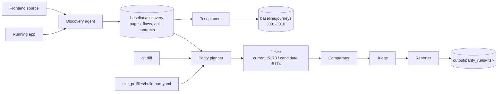

# Regression Agent Plan

## Goal

Make sure the React 19 migration (`react19/`) behaves like the current build, page by page and journey by journey. Every push or PR on the `migration` branch should report what changed and whether each change is expected, cosmetic or a regression.

## How the pieces fit



1. **Discovery** (`agents/discovery`) reads the source and explores the live app with Playwright MCP. It writes routes, pages, components, APIs, elements, flows and draft page contracts to `baseline/discovery/`. This is the only stage that needs an LLM to run.
2. **Test planner** (`agents/planner`) turns discovery flows into approved journey YAML under `baseline/journeys/`. It also builds a source map (routes, imports, shell files) so a git diff can be mapped to the pages it affects.
3. **Parity run** (`agents/parity`):
   - **Planner** picks the cells to run: all pages, or only the pages affected since `--base-ref`. Each cell is a page plus a sample (pinned and rotated) from the site profile.
   - **Driver** opens each cell on both builds and watches each contract region until it is `settled`, `stuck`, `missing` or `unlocatable`. It also captures text, ARIA, layout, metrics, console errors and network failures.
   - **Comparator** applies tolerance classes deterministically:
     - `VOLATILE`: format only (price, stock, copy)
     - `STRUCTURE`: ARIA snapshot, with digits masked
     - `BEHAVIOR`: role, name and enabled state
   - **Judge** classifies each diff, using human labels first, then expected changes, then the cache, then Claude. `--no-llm` skips the model call.
   - **Reporter** writes `report.json`, `report.html` and one defect file for each regression or `needs_review` item.
4. **E2E journeys** (`agents/e2e`) run journey steps on both builds, and `parity/journeys.py` compares the results.
5. **CI** (`ci/*.sh` and `.github/workflows/regression.yml`) starts the backend and both builds, runs the comparison, uploads the report and posts a markdown summary.

## Current state

| Area | Status |
|------|--------|
| Discovery baseline | Done. 13 pages, 9 components, 10 flows, APIs and elements captured |
| Page contracts | **All 13 are still `draft`.** None have been reviewed or approved |
| Journeys | 10 generated (J001-J010) across home, products, cart and account |
| Site profile | `buildmart.yaml` only |
| Parity pipeline | Built end to end: plan, drive, compare, judge, report, plus `label` and `summary-md` |
| CI | `start.sh`, `compare.sh`, `stop.sh` and the GitHub workflow are wired up. Diffs give a warning but do not fail the build |
| Tests | `test_parity`, `test_test_planner`, `test_contracts`, `test_journey_compare` |
| React 19 build | Only partly migrated (home page, header, location selector). Pages that are not built yet are reported as unavailable |
| Docs | The root README has no section on the regression agent |

## Next steps

### Phase 1: Trust the baseline
- [ ] Review and approve every contract in `baseline/discovery/contracts/`. For each region, confirm the tolerance class, locator, format rule and settle timeout.
- [ ] Replace brittle or index-based locators with role/name locators. Remove `unlocatable` regions.
- [ ] Review J001-J010 against the flows. Retire any journeys that are noisy.
- [ ] Re-run discovery in `contracts` mode only to fill gaps, without regenerating everything.

### Phase 2: Stable parity runs
- [ ] Run `--all` with `--no-llm` several times against the same build to measure flakiness. Any diff found this way is noise to fix.
- [ ] Add a retry for regions that come back `stuck` or `missing` before reporting them.
- [ ] Fix the sample rotation seed per CI run so a rerun can be reproduced.
- [ ] Label the known diffs (`python -m agents.parity label ...`) so the judge stops asking about them.
- [ ] Add a version to the judgment cache (prompt and model) so stale answers get invalidated.

### Phase 3: Cover the migration
- [ ] As each React 19 page lands, move it from unavailable to compared. Track progress in the run summary.
- [ ] Run journeys in CI next to the page cells, covering cart, checkout up to place order, and login/logout.
- [ ] Add thresholds for performance metrics (TTFB, FCP, load, CLS) so slow pages raise a `slow` diff with clear limits.

### Phase 4: Gate and operate
- [ ] Turn on failure in `compare.sh` when there are unlabelled `regression` judgments. Keep `needs_review` as a warning.
- [ ] Make ports and URLs configurable through env instead of hardcoding 5173, 5174 and 8000.
- [ ] Keep a short history of runs (counts by classification) to show trends across the migration.
- [ ] Add a regression agent section to the README covering setup, the three CLIs, CI flow and how to label.

## Done when

- All contracts are approved and all migrated pages are compared on every PR to `migration`.
- Running the same build twice gives zero diffs.
- Every diff in a run is judged, and `regression` blocks the merge.
- Someone new can run discovery, planner and parity locally from the README alone.

## Commands

```bash
cd tools/regression-agent
uv run python -m agents.discovery --project-path ../../react19 --url http://127.0.0.1:5173 --backend-url http://127.0.0.1:8000 --mode full
uv run python -m agents.planner
uv run python -m agents.parity run --site-profile baseline/site_profiles/buildmart.yaml \
  --current-url http://127.0.0.1:5173 --candidate-url http://127.0.0.1:5174 --all
uv run python -m agents.parity summary-md output/parity_runs/<ts>
uv run pytest tests/
```
